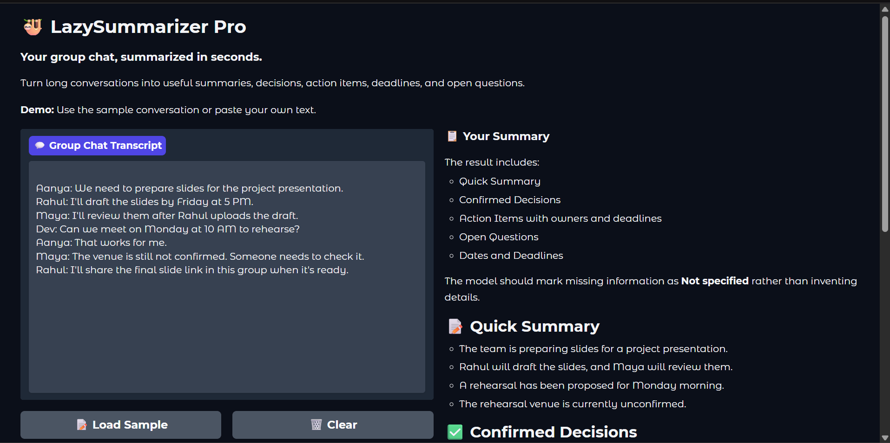
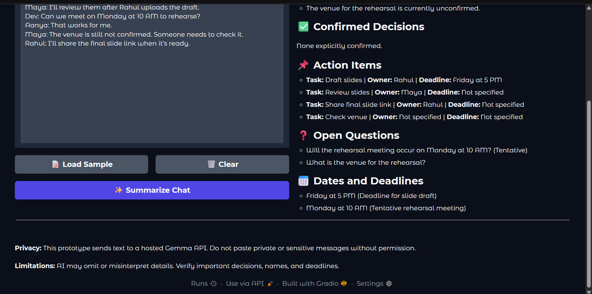

# 🦥 LazySummarizer Pro

### Your group chat, summarized in seconds.

LazySummarizer Pro is an educational prototype that turns a long group-chat transcript into a concise summary, possible action items, deadlines, tentative plans, and open questions. It uses **Google Gemma through the hosted Gemini API** and a **Gradio** interface.

> **Important:** This is a prototype, not a guaranteed fact-checking system. Review names, decisions, dates, and action items before relying on the output.

## ✨ Features

- 📝 **Quick summary** — condenses a conversation into short bullet points.
- ✅ **Confirmed decisions** — separates explicit decisions from proposals where possible.
- 📌 **Action items** — extracts tasks, owners, and deadlines; missing information should be marked as `Not specified`.
- ❓ **Open questions** — surfaces unresolved details and tentative plans.
- 📅 **Dates and deadlines** — collects dates or times explicitly mentioned in the transcript.
- 🧪 **Sample conversation** — lets you test the app without using private messages.
- 🖥️ **Gradio UI** — paste a transcript, click **Summarize Chat**, and read the structured result.

## 🧰 Technology

- Python
- Google Gen AI SDK (`google-genai`)
- Google Gemma model: `gemma-4-26b-a4b-it` (the model used in the successful prototype test)
- Gradio
- Google Colab for development and testing

## 🚀 Run the notebook in Google Colab

The primary runnable version is the Colab notebook.

1. Open `lazy_summarizer_pro.ipynb` in Google Colab.
2. In Colab's **Secrets** panel, add a secret named `GEMMA_API_KEY` and enable notebook access.
3. Run the cells in order: dependency setup, API connection test, summarization function, and Gradio interface.
4. Open the temporary `gradio.live` URL printed by the final cell.
5. Paste a transcript or use the sample conversation, then click **Summarize Chat**.

Create an API key in [Google AI Studio](https://aistudio.google.com/apikey). Never paste the key directly into notebook code, publish it in this repository, or share it in screenshots.

### Dependencies

A minimal `requirements.txt` can contain:

```text
google-genai
gradio
```

The Colab notebook currently installs these packages in its setup cell. Package versions may change, so record tested versions if reproducibility is important.

## 🧪 Example input

```text
Riya: I may send the report tomorrow.
Aman: We can meet next week if everyone is free.
```

A useful summary should identify the report and meeting as tentative, avoid inventing a calendar date, and note that the meeting depends on everyone's availability. The model can still make mistakes, so outputs must be checked.

## 🔐 Privacy and limitations

- This prototype sends transcript text to a **hosted Gemma API** for summarization. It is **not an offline application**.
- Do not paste private or sensitive group chats unless you have permission and have reviewed the provider's applicable data-handling terms.
- Low temperature and careful prompting may reduce variability, but they do not guarantee zero hallucinations.
- The model may omit details, misunderstand context, or label a proposal incorrectly.
- Relative terms such as “tomorrow” and “next week” are not exact calendar dates unless the relevant date context is available.
- The Gradio share URL is temporary and may expire when the runtime stops.

## 📸 Screenshots

### Dashboard


### Summary Results


## 🛣️ Future improvements

- Add regression tests for missing deadlines, tentative plans, and conflicting messages.
- Improve structured output validation before displaying a summary.
- Support longer transcripts with chunking and cross-chunk context.
- Offer an optional local inference mode with an appropriately sized open-weight model.
- Add export to Markdown or text files.
- Evaluate summary quality on a documented set of synthetic test conversations.

## 🏁 Hacktoberfest Week 3

Built for the **Hacktoberfest Open-Source AI Challenge: Week 3 — “Slow and Steady.”** The goal is to reduce the effort required to process long conversations by presenting the information people need to act.

Required DEV Challenge tags: `#devchallenge` and `#hf26challenge`.

## 📄 License

Add a license file to the repository before explicitly granting others permission to reuse, modify, or distribute this project.
